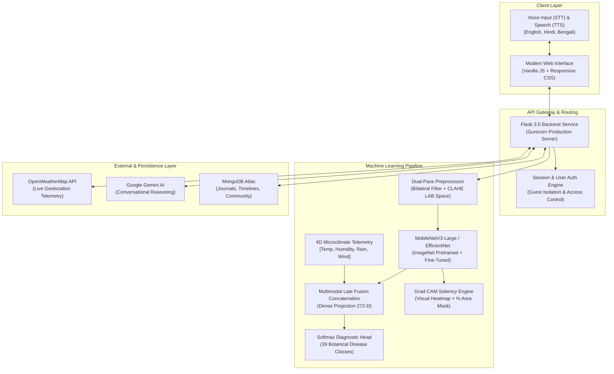

# 🌿 AgroIntelli — Multimodal Precision Crop Pathology & Agronomic Intelligence

[](https://www.python.org/)
[](https://www.tensorflow.org/)
[](https://github.com/rahulkr90930/Agrointelli)
[](https://github.com/rahulkr90930/Agrointelli)
[](https://www.mongodb.com/atlas)
[](LICENSE)

**AgroIntelli** is an end-to-end precision agriculture platform designed to bridge the gap between laboratory diagnostic benchmarks and unpredictable outdoor field conditions. By combining **deep visual feature representations** with **live 4D microclimate telemetry**, AgroIntelli delivers early pathogen diagnosis, Explainable AI (Grad-CAM) lesion quantification, multi-day disease trajectory modeling, and multilingual conversational agronomy for smallholder farmers and agricultural enterprises.

---

## 📌 Executive Summary & Key Highlights

* **Multimodal Late Fusion Architecture**: Plant diseases do not develop in isolation. AgroIntelli merges deep visual CNN embeddings (MobileNetV3 / EfficientNet-B0) with real-time environmental vectors (ambient temperature, relative humidity, precipitation, wind velocity) via late feature concatenation to capture microclimatic infection windows.
* **Dual-Pass Field Illumination Ensemble**: Resolves extreme outdoor lighting variations (direct sunlight glare, harsh shadows) by soft-voting between an enhanced LAB-space CLAHE / Bilateral Filter pass (65%) and native RGB features (35%).
* **Explainable AI (XAI) & Lesion Saliency**: Computes Grad-CAM attention heatmaps paired with automated OpenCV mask thresholding to calculate the exact **percentage of infected leaf blade area**.
* **Longitudinal Disease Trajectory Modeling**: Tracks multi-scan recovery dynamics across user-defined intervals (e.g. Day 1, Day 5, Day 10) to calculate pathogen velocity (% delta/day) and assess chemical/organic treatment efficacy.
* **AgroBot Conversational Agronomist**: A context-grounded AI consultant supporting voice input (STT) and audio playback (TTS) in **English, Hindi, and Bengali**, with dedicated prophylaxis/prevention advice, live microclimate risk assessment, and MongoDB timeline review.
* **Dual-Tier Resilient Storage**: Full MongoDB Atlas cloud persistence for user accounts, private plant journals, timeline scans, and community discussions, with transparent offline fallback to local JSON storage.

---

## 🏗️ System Architecture



---

## 🔬 Machine Learning & Training Methodology

### 1. Unified 39-Class Fused Dataset
To prevent laboratory overfitting, the training corpus unifies two standard agricultural benchmarks:
* **PlantVillage Dataset**: High-resolution studio leaf captures under controlled lighting.
* **PlantDoc Dataset**: In-the-wild agricultural field photos featuring complex backgrounds, soil, multiple overlapping leaves, and shadows.
* **Scale**: **62,669 total verified images** standardized across **14 crop ecosystems** into a canonical 39-class pathology taxonomy.

### 2. Two-Stage Transfer Learning Protocol
Training was executed in two staged phases using an infinite streaming `tf.data.Dataset` generator with in-graph GPU data augmentation (RandomFlip, RandomRotation $\pm 15\%$, RandomZoom $\pm 15\%$, RandomContrast $\pm 15\%$):

| Training Phase | Active Layers | Learning Rate | Loss Function | Train Acc | Val Acc | Top-3 Val Acc |
| :--- | :--- | :--- | :--- | :--- | :--- | :--- |
| **Stage 1: Head Warmup** (Epochs 1–5) | Backbone Frozen | $1 \times 10^{-3}$ | Label-Smoothed CCE ($0.1$) | 92.40% | 94.72% | 98.99% |
| **Stage 2: End-to-End Fine-Tuning** (Epochs 6–20) | Top 35 Layers Unfrozen | $1 \times 10^{-4}$ (Cosine Decay) | Label-Smoothed CCE ($0.1$) | **98.67%** | **98.31%** | **99.69%** |

*For full layer-by-layer architectural diagrams, parameters, and confusion matrix data, see [docs/MODEL_TRAINING_AND_FUSION.md](docs/MODEL_TRAINING_AND_FUSION.md).*

---

## 💻 Tech Stack

* **Backend & API**: Python 3.11.9, Flask 3.0, Gunicorn, Werkzeug
* **Deep Learning & Computer Vision**: TensorFlow 2.16.2, Keras, OpenCV (`cv2`), NumPy, Scikit-learn
* **Database & Persistence**: MongoDB Atlas, PyMongo (with transparent local JSON fallback)
* **Cloud & External Services**: OpenWeatherMap API, Google Gemini API, Render Cloud Platform
* **Frontend**: Vanilla JavaScript (ES6+), Modern Semantic HTML5, CSS3 Custom Properties (Zero bloated frontend frameworks)

---

## ⚡ Quickstart & Local Installation

### Prerequisites
* **Python 3.11** (64-bit installation; pinned to Python 3.11.9).
* **Git** installed on your system.

### 1. Clone the Repository
```bash
git clone --branch v2 --single-branch https://github.com/rahulkr90930/Agrointelli.git
cd Agrointelli
```

### 2. Create and Activate Virtual Environment
**On Windows (PowerShell):**
```powershell
py -3.11 -m venv venv
.\venv\Scripts\Activate.ps1
```
*(If PowerShell restricts script execution, run: `Set-ExecutionPolicy -Scope Process -ExecutionPolicy Bypass`)*

**On macOS / Linux:**
```bash
python3.11 -m venv venv
source venv/bin/activate
```

### 3. Install Dependencies
```bash
python -m pip install --upgrade pip
python -m pip install -r requirements.txt
```

### 4. Configure Environment Variables (Optional)
Create a `.env` file in the project root:
```env
PORT=5000
MONGO_URI=your_mongodb_atlas_connection_string
MONGO_DB_NAME=agrointelli
OWM_API_KEY=your_openweathermap_api_key
GEMINI_API_KEY=your_google_gemini_api_key
```
*(Note: AgroIntelli runs out-of-the-box with built-in mock weather, local JSON storage, and a deterministic local agronomic expert if cloud API keys are omitted).*

### 5. Launch Application
```bash
python run.py
```
The server will initialize the neural weights, launch the Flask API at `http://127.0.0.1:5000`, and automatically open your default browser.

---

## 🌐 Public Sharing & Cloud Deployment

### Instant Public Tunnel (Zero-Setup Sharing)
To share your local server with friends or evaluators on mobile devices without port-forwarding:
* **Windows One-Click**: Double click [`start_tunnel.bat`](start_tunnel.bat)
* **PowerShell / Terminal**:
  ```bash
  ssh -o StrictHostKeyChecking=accept-new -p 443 -R0:127.0.0.1:5000 nokey@localhost.run
  ```
  Copy the generated `https://...lhr.life` link and open it on any device.

### 24/7 Cloud Deployment (Render Blueprint)
The repository includes a production-ready [`render.yaml`](render.yaml) blueprint:
1. Fork or push this repository to GitHub.
2. Sign in to [Render](https://render.com) and click **New → Blueprint**.
3. Select your repository and the `v2` branch.
4. Render will automatically build the environment, run health checks, and provide a persistent HTTPS URL (e.g. `https://agrointelli.onrender.com`).

---

## 📡 REST API Reference

| Endpoint | Method | Parameters | Description |
| :--- | :--- | :--- | :--- |
| `/health` | `GET` | — | Returns server heartbeat, active ML models, and database connectivity mode. |
| `/predict` | `POST` | `image` (file), `plant` (opt), `use_weather` (bool) | Executes single leaf neural diagnosis with Grad-CAM heatmap and % area infected. |
| `/batch_predict` | `POST` | `day1`, `day5`, `day10` (files), `labels` (JSON) | Analyzes multi-day progression, computing rate of spread and clinical trajectory. |
| `/api/chat` | `POST` | `message`, `history`, `context`, `language` | Context-grounded multi-turn agronomic conversation engine. |
| `/api/records` | `GET` / `POST`| `user_id` | Retrieves or saves personal plant journal tracking records. |
| `/api/records/<id>/recheck` | `POST` | `image`, `custom_date` | Appends a sequential follow-up scan to a tracked plant timeline. |
| `/api/community/posts` | `GET` / `POST`| `crop` (opt), `content`, `author` | Community discussion feed with upvoting, downvoting, and nested replies. |

---

## 💡 Engineering Highlights & Interview Talking Points

1. **Why Multimodal instead of Pure Vision?**
   * *Context*: Fungal pathogens like *Phytophthora infestans* (Late Blight) only sporulate under high humidity (>80%) and moderate temperatures (12–24°C). Under arid conditions, identical visual discoloration may indicate simple potassium deficiency or sun scorch.
   * *Solution*: Incorporating a 4D microclimate vector into the late fusion layer allows the model to shift diagnostic priors dynamically based on real-time environmental risk.
2. **Overcoming Outdoor Domain Shift**:
   * *Problem*: Laboratory benchmark models trained solely on clean studio backgrounds (PlantVillage) fail catastrophically in outdoor fields due to leaf glare, dust, and shadow artifacts.
   * *Solution*: Fusing PlantDoc field images into the training set and executing a dual-pass inference ensemble (65% Bilateral+CLAHE / 35% Raw) stabilized outdoor diagnostic reliability.
3. **Graceful Degradation Pattern**:
   * If MongoDB Atlas is unreachable, the system transparently swaps to local JSON persistence with zero downtime.
   * If Google Gemini API is throttled or offline, the conversational engine seamlessly falls back to a deterministic, rule-grounded local agronomic expert.

---

## 📄 License
This project is open-source and distributed under the [MIT License](LICENSE).
